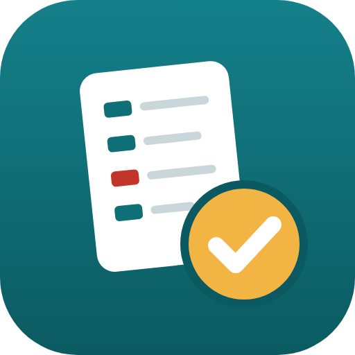

# App Review for Claude

Find out why your iOS app was rejected, how to fix it, and whether your next build will be rejected for the same thing.

Type `/appreview` in Claude Code (or ask Claude about an App Store rejection) and it will:

- **Explain your rejections.** It finds every app in your App Store Connect account with a rejection or Unresolved Issues, reads App Review's message, maps it to the [App Review Guidelines](https://developer.apple.com/app-store/review/guidelines/), and tells you the cause, the fix (metadata only, new build, or information only) and a reply you can send to App Review.
- **Check a project before you submit.** Run `/appreview check` in an app project. It scans the code for the problems that most often get apps rejected (missing permission explanations, privacy manifest, account deletion, Sign in with Apple, Restore Purchases, tracking prompt, staging servers, placeholder text and more), and checks the project against your own past rejections so the same mistake doesn't ship twice.
- **Give you a report.** Results come as an HTML page: each finding with its guideline number, where it is in your code, numbered fix steps, and a copy button for reply drafts.

Everything is read-only. It never replies to App Review, resubmits, edits your App Store listing or changes your code unless you ask it to fix something afterwards.

## Install

**From Anthropic's directory** (once listed): add **App Review** on claude.ai. It syncs to Claude Code and appears in `/skills` as `/appreview`.

**From this repository, in your terminal:**

```bash
claude plugin marketplace add velozjuan/appreview
claude plugin install appreview@appreview
```

**By hand:** copy `skills/appreview` into `~/.claude/skills/appreview`.

You need Python 3.9 or later. Connecting with an API key also needs the `cryptography` package (`pip install cryptography`).

## Connect your App Store Connect account

You have two options. Claude asks which one you want the first time.

1. **API key (fastest for open rejections).** In App Store Connect, go to **Users and Access > Integrations > App Store Connect API**, create a Team Key with the **App Manager** role, and download the `.p8` file. When you enable the plugin, Claude Code asks for the Key ID, the Issuer ID and where the `.p8` file is (change them later with `/config`). For a manual install, set `ASC_KEY_ID`, `ASC_ISSUER_ID` and `ASC_PRIVATE_KEY_PATH` instead. Never paste the contents of the `.p8` into a chat.
2. **Your browser (no key).** Claude opens App Store Connect in a browser where you're signed in, goes through your apps and reads the App Review messages. You sign in yourself; Claude never asks for your Apple ID password or codes, and it only reads.

Good to know: Apple's API shows rejections that are still open, but not past rejections that were later fixed. For history, and for the reviewer's message itself, the skill reads the App Review pages in your browser or asks you to paste the message.

## Data and network use

What the skill reads, sends and stores:

| What | Where it goes | When |
|---|---|---|
| Signed, read-only requests (`GET` only) with a token made from your API key | `api.appstoreconnect.apple.com` (Apple) | API key mode |
| Your browser session, read only | `appstoreconnect.apple.com` (Apple), in your own browser | Browser mode |
| Nothing (just reads the public page) | `developer.apple.com` | To check the current guideline text |
| Your project's source files, read locally | Nowhere: the scan runs on your machine | Submission check |
| Rejection history (app name, bundle ID, version, date, guideline, reviewer's words) | `~/.appreview/history.json` on your computer | After a rejections report |
| Report page fonts | `fonts.googleapis.com` / `fonts.gstatic.com`, when the report is opened | Report |

The key file is read from where you keep it to sign requests and is never copied, uploaded or stored by the skill. Reports and the history never contain passwords, demo account credentials, contact details or keys, and code snippets in reports have long tokens masked. Claude itself sees what the skill reads, as with any Claude Code session.

## What the submission check looks for

| Guideline | Check |
|---|---|
| 5.1.1 | Permission APIs used without an explanation string, or with a vague one |
| 5.1.1 / ITMS-91053 | Required-reason APIs without a privacy manifest entry |
| 5.1.1(v) | Account sign-up with no in-app account deletion |
| 5.1.1(i) | No privacy policy link in the app |
| 4.8 | Google or Facebook login without Sign in with Apple or an equivalent |
| 3.1.1 / 3.1.2 | In-app purchases without Restore; subscriptions without terms links; outside checkouts |
| 5.1.2 | Advertising identifier or ad SDKs without the App Tracking Transparency prompt |
| 2.1 | Placeholder text, staging or localhost servers |
| 1.2 | Posting or chat without report and block |
| 2.5.1 / 2.5.2 | Private API patterns, hot-patching frameworks |
| 4.2 | Very small apps built around a web view |

It works with Swift and Objective-C projects, and with React Native, Expo, Flutter and Capacitor apps. Findings are confirmed by Claude reading the code before they're reported. Static checks can't see your App Store listing, App Privacy answers, demo account or runtime crashes, so those come up as items to check by hand. A clean check doesn't guarantee approval.

## Repository layout

```
.claude-plugin/plugin.json        plugin manifest and key settings
.claude-plugin/marketplace.json   lets Claude Code install from this repo
skills/appreview/SKILL.md         the skill
skills/appreview/scripts/         Python scripts (API client, scans, report)
skills/appreview/references/      guideline playbook, setup and workflow notes
```

Run `python3 skills/appreview/scripts/selftest.py` to test the scripts offline against a mock of the App Store Connect API.

## License

MIT. Not affiliated with or endorsed by Apple. App Store, App Store Connect and iOS are trademarks of Apple Inc.
